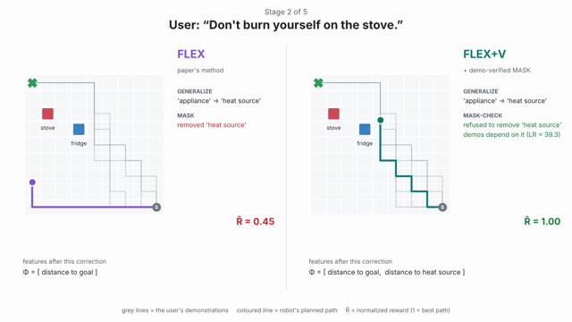
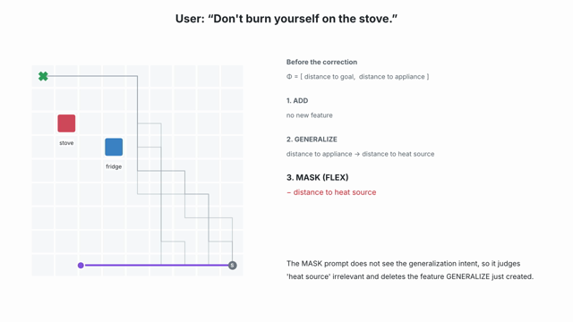
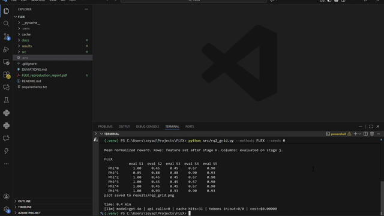
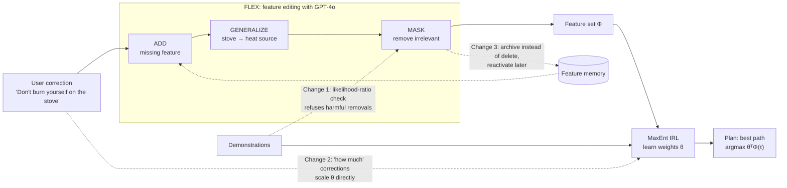
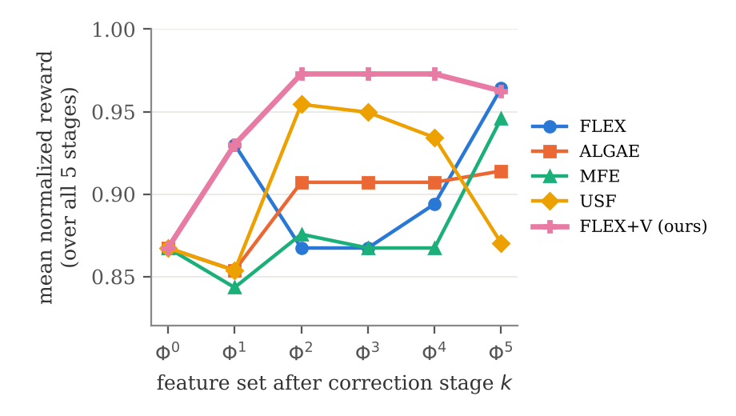
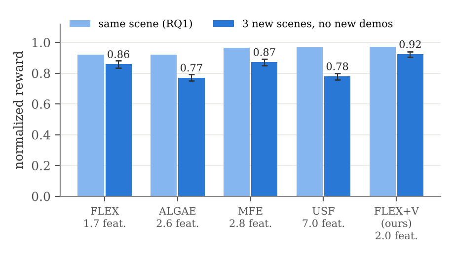

# Reproducing FLEX — Flexible Language-Guided Representation Editing

A from-scratch reimplementation of **FLEX** ([Lee, Dennler, Sucholutsky & Bobu, arXiv:2610.28893](https://arxiv.org/abs/2610.28893)), a diagnosis of why a faithful reimplementation falls short of the paper's Table 1, and three changes that address the method's limitations.

📄 **Report (5 pages):** [`docs/FLEX_reproduction_report.pdf`](docs/FLEX_reproduction_report.pdf)
📝 **Every implementation choice and observation:** [`DEVIATIONS.md`](DEVIATIONS.md)  
🎬 **Demo videos:** [below](#demo-videos)

> The official repository ([MIT-CLEAR-Lab/FLEX](https://github.com/MIT-CLEAR-Lab/FLEX)) contained no code when this work was done (12 Nov 2026), so everything here is built from the paper and its appendix prompts.

---

## Key results

| | Result |
|---|---|
| **Reproduction (RQ1)** | Faithful FLEX averages **0.92** normalized reward vs. **0.99** in the paper |
| **Diagnosis** | MASK deletes the feature GENERALIZE has just created in **21 / 70** runs (prompt conflict, not a parsing or model issue) |
| **Change 1: demo-verified MASK** | RQ1 **0.92 → 0.98**; RQ2 correct features after **2** corrections instead of 5; zero extra LLM calls |
| **Transfer to new scenes** | FLEX + check **0.92** with 2.0 features vs. USF **0.78** with 7.0 features, supporting the paper's "compact, transferable" claim |
| **Change 2: language → θ** | "Stay further / you can get closer" corrections: **0.84 → 0.99** |
| **Change 3: feature memory** | Returning preference: **+3 points** with one demonstration, **−11 %** LLM calls |

---

## Demo videos

Click a picture to open the video. Videos 1 and 2 replay the RQ2 run from the report (seed 0) using the cached GPT-4o answers, so they show the real decisions of the model, not a mock-up.

| 1. Five corrections in a row (45 s) | 2. Why FLEX loses the feature (31 s) | 3. The code running (56 s) |
|:---:|:---:|:---:|
| [](docs/videos/rq2_sequence.mp4) | [](docs/videos/mask_failure.mp4) | [](docs/videos/code_run.mp4) |
| FLEX vs. FLEX+V side by side: the robot's path after each correction, the operations that ran and the normalized reward. | One correction step by step: ADD → GENERALIZE → MASK. FLEX deletes the heat-source feature; FLEX+V's demo check keeps it (LR = 39.3). | `python src/rq2_grid.py --methods FLEX --seeds 0` in VS Code: same numbers as video 1, 0 API calls, $0. |

Regenerate videos 1 and 2 with `python src/make_videos.py` (about 3 min, no API key needed; uses `ffmpeg`).

---

## How FLEX works (and what we added)



The reward is linear in features, $R_\theta(\tau)=\theta^\top\Phi(\tau)$. Language decides **which** features Φ exist; demonstrations decide **how much** each matters (θ). Dotted arrows are our changes.

---

## Results

### RQ1: are all three operations necessary? (normalized reward, 1 = optimal)

| Method | Add | Gen | Mask | Add+Gen | Add+Mask | Mask+Gen | All three | **Avg** |
|---|---|---|---|---|---|---|---|---|
| *Paper:* FLEX | 1.00 | .91 | 1.00 | 1.00 | 1.00 | 1.00 | .99 | **.99** |
| *Paper:* ALGAE | 1.00 | .59 | .95 | .77 | .59 | .63 | .69 | .75 |
| *Paper:* MFE | .95 | .70 | 1.00 | .75 | .43 | .67 | .83 | .76 |
| *Paper:* USF | .64 | .72 | .90 | .80 | .99 | .78 | .78 | .80 |
| **Ours:** FLEX (faithful) | .97 | .93 | .95 | .92 | .96 | .90 | .81 | **.92** |
| **Ours:** ALGAE | .98 | .86 | 1.00 | .83 | .97 | .94 | .87 | .92 |
| **Ours:** MFE | .99 | .88 | .99 | .99 | .99 | 1.00 | .91 | .96 |
| **Ours:** USF | .99 | .94 | .99 | .99 | .99 | .94 | .94 | .97 |
| **Ours: FLEX + MASK check** | .99 | .99 | .99 | .98 | .99 | .98 | .93 | **.98** |
| **Ours: + GENERALIZE check** (current code) | .99 | .93 | 1.00 | .98 | .99 | .99 | .93 | .97 |

10 runs per cell (KitchenWorld + LavaLand × 5 seeds), GPT-4o (`gpt-4o-2024-08-06`, temperature 0).

### RQ2: a sequence of five corrections

<p align="center"></p>

Faithful FLEX reaches the right features only at stage 5, because MASK deletes *heat source* at stages 2 and 4. With the demo check, the right features hold from stage 2 onward.

### Transfer: does what was learned work in a new scene?

<p align="center"></p>

In the scene where they learned, three methods tie at 0.97. Applied to new scenes without new demonstrations, compact and general feature sets transfer best.

### Change 2: corrections that say *how much*

| Correction (true change of the stove weight) | FLEX | **FLEX + θ** |
|---|---|---|
| "Stay much further away from the stove, even if you are farther from the fridge." (×3) | .79 | **1.00** |
| "Keep a bit more distance from the stove." (×2) | .86 | **.99** |
| "You can get closer to the stove, it's not that hot." (×0.3) | .81 | **.97** |
| "Getting a little closer to the stove is okay." (×0.5) | .89 | **1.00** |

False positives on ordinary corrections: **2 / 16** in realistic contexts, **0 / 5** when the related feature is already present.

### Change 3: feature memory when a preference returns

| | 1 demo | 2 demos | 5 demos | LLM calls |
|---|---|---|---|---|
| FLEX + check | .86 | .89 | .91 | 7.6 |
| **+ memory** | **.89** | **.91** | **.92** | **6.8** |

---

## Setup

Requires **Python 3.10+** and an OpenAI API key.

```bash
git clone https://github.com/zeyad4231/FLEX.git
cd FLEX
python -m venv .venv
# Windows (PowerShell):   .venv\Scripts\Activate.ps1
# macOS / Linux:          source .venv/bin/activate
pip install -r requirements.txt
```

Create a file named `.env` in the project folder (it is ignored by git):

```
OPENAI_API_KEY=sk-...
FLEX_MODEL=gpt-4o
```

Without `FLEX_MODEL`, the code defaults to `gpt-4o-mini` (cheap, for debugging). All reported numbers use `gpt-4o`.

**Caching.** Every LLM answer is saved in `cache/` (keyed by model, prompt and temperature). Re-running an experiment whose answers are cached is free and gives identical results. Running everything from an empty cache costs roughly **$7** with `gpt-4o`.

---

## Reproducing the results

Run all commands from the main project folder. Quick self-tests first (each file has a small demo at the bottom):

```bash
python src/llm.py         # one LLM call, then the same call again from the cache
python src/gridworld.py   # builds the 9×9 world and its 12,870 paths
python src/irl.py         # checkpoint: correct features give normalized reward ≈ 1 (no API calls)
python src/flex.py        # one FLEX update on the paper's "All three" scenario
```

Then the experiments:

| Result | Command | Output in `results/` | Approx. time |
|---|---|---|---|
| RQ1, paper's four methods | `python src/rq1.py` | `rq1.json`, `rq1_table.md` | 40 min |
| RQ1, FLEX + checks | `python src/rq1.py --methods FLEX+V --out results/rq1_flexV2` | `rq1_flexV2.json` | 5 min |
| Diagnosis of the over-masking | `python src/diagnose_rq1.py` | printed | < 1 min |
| RQ2, paper's four methods | `python src/rq2_grid.py` | `rq2_grid.json`, `rq2_grid.png` | 25 min |
| RQ2, FLEX + checks | `python src/rq2_grid.py --methods FLEX+V --out results/rq2_flexV` | `rq2_flexV.json` | 5 min |
| Transfer to new scenes | `python src/rq1_transfer.py` | `rq1_transfer.json`, `rq1_transfer_table.md` | 20 min |
| Change 3: feature memory | `python src/improvement1_memory.py --out results/improvement1_memory_v3` | `improvement1_memory_v3.json` | 2 min |
| Change 2: language → θ | `python src/improvement2_theta.py --out results/improvement2_theta_v2` | `improvement2_theta_v2.json` | 3 min |
| Demo videos 1 and 2 | `python src/make_videos.py` | `docs/videos/*.mp4` | 3 min |

Times are with cached answers on a laptop CPU; most time goes into evaluating features on all 12,870 paths. Useful flags for `rq1.py` and `rq2_grid.py`: `--methods`, `--seeds`, `--domains`, `--scenarios`, `--out`.

> For a quick test run, add `--out results/test`: without it, `rq1.py` and `rq2_grid.py` overwrite the full results in `results/`.

> `results/rq1_flexV.json` was produced by an earlier commit where only MASK was checked (row "FLEX + MASK check" above). The current code also checks GENERALIZE (row "+ GENERALIZE check").

---

## Project structure

```
FLEX/
├── src/                      all code (run scripts from the main folder: python src/<script>.py)
├── results/                  JSON results, tables and plots from every experiment
├── cache/                    every GPT answer (makes re-runs free and identical)
├── docs/                     report PDF and figures
│   └── videos/               the three demo videos
├── DEVIATIONS.md             all choices the paper leaves open, observations, changes
├── README.md
└── requirements.txt
```

| File in `src/` | What it does |
|---|---|
| `llm.py` | Every GPT call: caching, retries, token and cost tracking |
| `gridworld.py` | 9×9 KitchenWorld / LavaLand, object properties, all 12,870 corner-to-corner paths |
| `irl.py` | Features, ground truth, simulated demos (Eq. 2), MaxEnt IRL (Eq. 3), normalized reward, demo-likelihood check |
| `prompts.py` | The paper's appendix prompts, copied verbatim (two adaptations marked `ADAPTED`) |
| `flex.py` | ADD / GENERALIZE / MASK, sandbox for LLM-written feature code, feature memory |
| `baselines.py` | ALGAE (add only), MFE, USF, and `FLEX+V` (FLEX + checks) |
| `theta_language.py` | Change 2: classifies "which" vs. "how much" corrections and scales θ |
| `rq1.py` | RQ1: 7 scenarios × 2 worlds × 5 seeds |
| `rq2_grid.py` | RQ2: the five-stage correction sequence in the grid world |
| `rq1_transfer.py` | Learned rewards applied to new scenes without new demonstrations |
| `improvement1_memory.py` | Change 3: returning-preference experiment |
| `improvement2_theta.py` | Change 2: "how much" experiment and false-positive check |
| `diagnose_rq1.py` | Finds the over-masking runs and checks every cached MASK answer |
| `make_videos.py` | Demo videos 1 and 2, replayed from the cache |

---

## Limitations of this reproduction

- The **7-DoF Franka** domain and the **user study** were not reproduced; RQ2 was rebuilt in the grid world with the same five-stage structure.
- ALGAE is approximated as FLEX with only the ADD operation.
- The paper does not specify ground-truth weights, demonstration noise, layouts or LavaLand's object properties; our choices are listed in `DEVIATIONS.md`.
- The demo check is only as good as the evidence in the current scene's demonstrations, and it tests features one at a time.
- 5 seeds per setting: the feature-memory gain is suggestive, not statistically significant.

## Reference

> A. Lee, N. Dennler, I. Sucholutsky, A. Bobu. *Flexible Language-Guided Representation Editing for Adaptive Robot Behavior.* arXiv:2610.28893, 2026.
